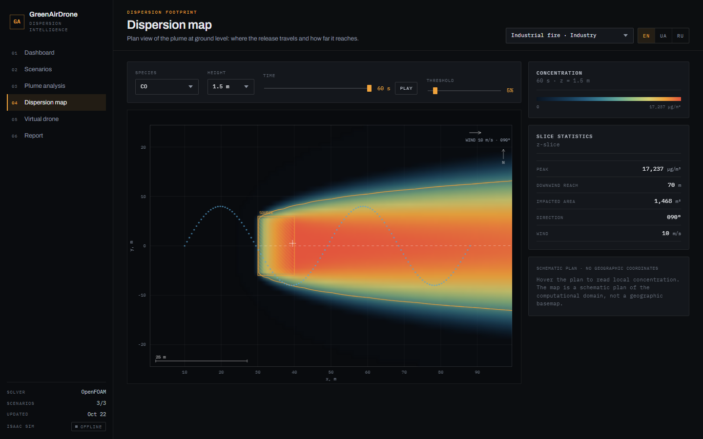
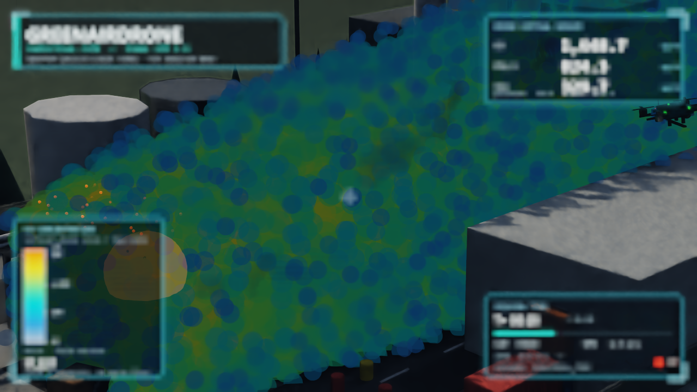
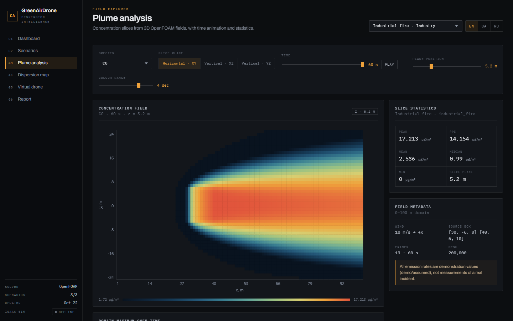

# GreenAirDrone

Atmospheric dispersion intelligence for emergency response: CFD plume fields, a
real-time 3D visualization in NVIDIA Isaac Sim, and a web platform for maps,
slice analysis, virtual drone measurements, and reports.

Author: **Романчук Платон, 10-ІТ**



## What it does

- Runs steady k-epsilon plume scenarios in **OpenFOAM 14** and exports
  concentration fields as time frames.
- Visualises the moving plume, fire and a virtual drone in **Isaac Sim 5.1**
  with a screen-space HUD and live telemetry.
- Serves a local **web application** with six sections: dashboard, scenarios,
  plume analysis, dispersion map, virtual drone, and report.
- Samples the computed field along a drone trajectory and compares measured
  values with model maxima.
- Speaks **English, Ukrainian, and Russian** in the UI.

| Isaac Sim plume | Analysis |
| --- | --- |
|  |  |

## Architecture

```
OpenFOAM 14 (WSL Ubuntu)          Isaac Sim 5.1                Web (FastAPI)
────────────────────────          ─────────────                ─────────────
steady k-epsilon      ──npz──▶    particles, HUD,       ──▶    REST API
13 frames, 0–60 s                 drone, cameras                vanilla JS + ECharts
        │                              │                              │
        └──────────── data/ ───────────┴──── status.json ─────────────┘
```

| Component | Stack |
| --- | --- |
| CFD | OpenFOAM 14, steady k-epsilon, U = 10 m/s along +X |
| Domain | 100 × 50 × 40 m, mesh 40 × 50 × 100 = 200 000 cells |
| Time | 13 frames, 0–60 s, 5 s step |
| 3D | Isaac Sim 5.1, 42 000 plume particles, RTX 3060, 960 × 540 |
| Web | FastAPI + vanilla JS + ECharts, port 8080 |

## Repository layout

```
greenair/              Isaac Sim application (scene, plume, HUD, drone)
  app.py               entry point, portable path resolution
  config.yaml          scenario and rendering settings
  assets/              generated HUD and smoke sprites
  tests/               data/trajectory unit tests
web/                   FastAPI server and static UI
  app.py               routes and static files
  core.py              scenario loading, slicing, statistics
  static/              HTML, CSS, JS, vendored ECharts
data/                  OpenFOAM exports and drone measurements (Git LFS)
docs/screenshots/      README images
run_demo.ps1/.cmd      one-command launcher
requirements-web.txt   web dependencies
requirements-isaac.txt Isaac Sim dependency note
```

## Requirements

- Windows 10/11 (the 3D viewer uses Isaac Sim and Windows fonts).
- NVIDIA Isaac Sim **5.1** with a compatible GPU (tested on RTX 3060).
- Python 3.11 for the web server.
- OpenFOAM is only needed to regenerate the fields; the exports are included.

## Quick start

The project is location independent: clone it into any folder, on any user
account. No path edits are required.

```powershell
git clone https://github.com/Alicebrokengirl/greenairdronesim.git
cd greenairdronesim
git lfs pull                     # downloads the CFD fields (~390 MB)

python -m venv venv
.\venv\Scripts\Activate.ps1
pip install -r requirements-web.txt

.\run_demo.ps1                   # web + Isaac Sim + browser
```

If Isaac Sim is installed in a different Python environment, point the launcher
at it:

```powershell
$env:GREENAIR_PYTHON  = "C:\path\to\isaacsim\python.exe"
$env:GREENAIR_PYTHONW = "C:\path\to\isaacsim\pythonw.exe"
```

### Web only

```powershell
cd web
..\venv\Scripts\python.exe app.py
```

Open <http://127.0.0.1:8080>. This is enough to explore all computed data; the
Isaac Sim panel simply reports "offline" until the viewer runs.

### Launcher flags

```powershell
.\run_demo.ps1 -SkipIsaac     # web only
.\run_demo.ps1 -SkipWeb       # Isaac only
.\run_demo.ps1 -NoBrowser     # do not open the browser
```

### Isaac Sim keyboard

`1` chase · `2` orbit · `3` ground · `4` top · `C` cycle camera ·
`5` cycle scene · `7/8/9` switch scenario · `H` HUD · `SPACE` pause ·
`R` restart · `ESC` quit

## Portability and environment variables

All paths are derived from the repository location (`Path(__file__)` and
`$PSScriptRoot`); there are no absolute `C:\isaac` references. `config.yaml`
stores `data_root: data`, resolved relative to the repo root.

| Variable | Default | Used by |
| --- | --- | --- |
| `GREENAIR_DATA` | `<repo>/data` | Isaac app, web server, tests |
| `GREENAIR_CAPTURES` | `<repo>/greenair/captures` | status channel and scenario switch file |
| `GREENAIR_PYTHON` | `<repo>/venv/Scripts/python.exe` | launcher (Isaac + web) |
| `GREENAIR_PYTHONW` | `<repo>/venv/Scripts/pythonw.exe` | launcher (web, hidden) |

Relative values are resolved against the repository root. On a machine without
the local `venv`, the launcher falls back to `python`/`pythonw` on `PATH` and
reminds you to install the web dependencies.

The web server and Isaac Sim communicate through
`greenair/captures/status.json` and `switch_scenario.txt`; both sides use the
same `GREENAIR_CAPTURES` directory.

## Data and scenarios

| Scenario | Folder | Species | Peak values (µg/m³) |
| --- | --- | --- | --- |
| Industrial fire | `data/industrial_fire` | 8 | CO 17 237 · PM2.5 8 619 · NO2 5 171 |
| Urban infrastructure fire | `data/urban_infrastructure_fire` | 6 | CO 20 417 · PM2.5 6 125 · NO2 3 063 |
| Debris dust | `data/debris_dust` | 6 | PM10 15 350 · PM2.5 9 210 · CO 2 456 |

Each scenario contains `export/fields_t*.npz` (13 frames), `export/timeseries.csv`,
`export/planes/*.csv`, `scenario_used.json`, and `drone_measurements.csv`.
Large exports are tracked with **Git LFS**; run `git lfs pull` after cloning.
A clone without LFS contains small pointer files and the web UI will show no
computed scenarios.

## Web sections

1. **Dashboard** — KPIs, live Isaac status, cross-scenario peaks.
2. **Scenarios** — case metadata, sources, species, limitations.
3. **Plume analysis** — XY/XZ/YZ slices, log colour scale, time animation.
4. **Dispersion map** — schematic plan with threshold contour, plume axis,
   drone track, downwind reach, and impacted area.
5. **Virtual drone** — 3D trajectory, concentration profile, sample log.
6. **Report** — printable summary with conditions, peaks, and JSON export.

## Model limitations

- The solver uses passive scalars: **no chemistry, aerosol dynamics, buoyancy,
  or deposition**. PM fractions are transported passively.
- Emission rates for part of the species are **demo/assumed**, not measurements
  of a real incident. The UI marks provenance explicitly.
- The dispersion map is a schematic plan of the computational domain, not a
  geographic basemap.
- Drone measurements are samples of the computed field along a synthetic
  trajectory, not physical sensor readings.

## Tests

```powershell
cd greenair
..\venv\Scripts\python.exe -m unittest discover -s tests -v
```

The tests validate field sampling, time interpolation, particle generation,
and trajectory interpolation against `data/industrial_fire`.

## License

No license is granted. © 2026 Романчук Платон. The source and data are published
for review and demonstration; redistribution or reuse requires the author's
permission.
